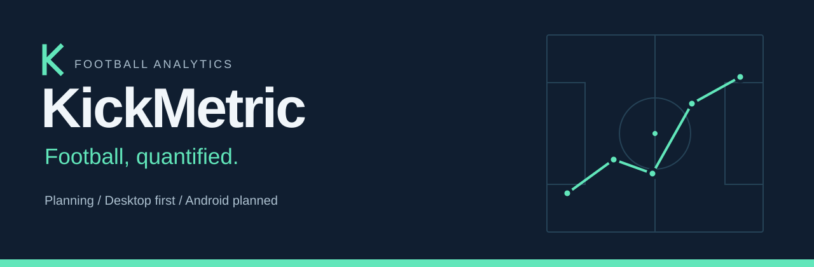

# KickMetric

**Football, quantified.**

Desktop-first football match forecasting and analysis of the information behind each forecast.

**Planning** · **Desktop first** · **Android planned**

## Current status

KickMetric is in planning. This repository contains project documentation and an initial visual identity. There is no working application, trained model, or downloadable release yet.

## Why KickMetric

A forecast should be understandable as well as measurable. KickMetric aims to help people explore football match probabilities, understand the information behind them, and assess forecasts against actual outcomes. Uncertainty belongs in the explanation, not in the fine print.

## Proposed initial capabilities

These are proposals for discussion, not approved or implemented features:

- Pre-match probabilities for home win, draw, and away win.
- Team-form and historical-performance comparisons.
- Explanations of the information used in a forecast.
- A record of forecasts and their subsequent outcomes.
- Evaluation against simple baseline predictions.

## Platform direction

A desktop application for PC comes first; Android is a future goal. Desktop operating systems and minimum requirements remain undecided. No platform builds are available.

## Roadmap

The proposed sequence moves from product definition to data feasibility, baseline evaluation, a desktop MVP, and release preparation. Android exploration follows as a separate future stage. There are no committed delivery dates.

See the [detailed roadmap](docs/roadmap.md) for stage boundaries and actual progress.

## Explore and contribute

Start with the [project vision](docs/vision.md), then read the [decision register](docs/decisions.md) to distinguish confirmed direction from open questions.

Use GitHub Issues to suggest improvements, discuss scope, or report documentation problems. Read the [contribution guide](CONTRIBUTING.md) before submitting changes. Substantial code contributions should wait until licensing and the implementation approach are clarified.

| Document | Purpose |
| --- | --- |
| [Vision](docs/vision.md) | Intended value and proposed scope |
| [Roadmap](docs/roadmap.md) | Proposed stages and completed foundation work |
| [Decisions](docs/decisions.md) | Confirmed, proposed, and pending decisions |
| [Contributing](CONTRIBUTING.md) | Participation during planning |
| [Agent guidelines](AGENTS.md) | Working agreement for coding agents |

## Limitations

Forecasts will be probabilistic, not guarantees. Predictive performance has not yet been established. The repository contains no example predictions or benchmark results.

## License

License selection is pending the project owner's decision.
